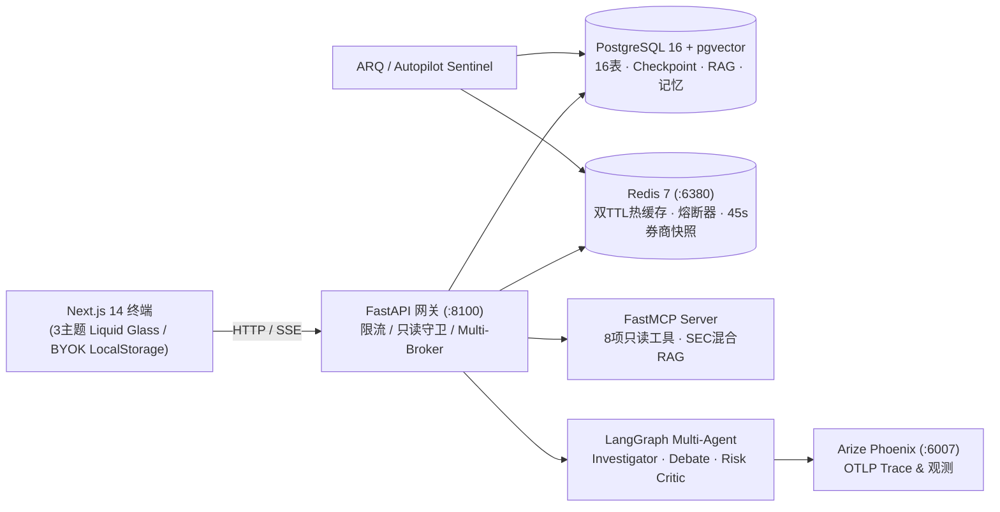

<div align="center">

# MarketElite v1.0

**Production-Grade US Equity Market Structure, DataOps / 4-Track Eval Governance & Closed-Loop Multi-Agent Risk Workstation**

[](./CHANGELOG.md)
[](./LICENSE)
[](#-快速启动0-key-开箱演示版--完整实时版)
[](#核心架构与工程亮点)
[](#五大一级工作台总览)

</div>

> **定位声明**：MarketElite 并非“带 K 线图表的套壳 ChatGPT”，而是一套由 **「1 个零 Token 确定性数据底座 + 3 个职责隔离的闭环自治 Agent + 4 层 DataOps 与 4-Track 全栈评测治理中台」** 构成的生产级金融投研工作台。

---

## 核心工程亮点

1. **零浪费算力隔离架构（Deterministic Pipeline vs Multi-Agent）**：宏观净流动性（`WALCL - WTREGEN - RRPONTSYD`）、Estimated GEX 期权墙、RVOL 相对量比、市场广度与风险算仓 **100% 由 Python 确定性算子 + Redis 双 TTL 热缓存定时完成**，首页驾驶舱直读缓存 **0 LLM Token 消耗**。
2. **三大独立闭环 Agent + FastMCP Tooling**：
   - **Investigator（首席调查与执行主脑）**：LangGraph ReAct 状态机，通过 FastMCP (`Streamable HTTP`) 并行调度 8 项只读工具与 SEC 10-K/10-Q/8-K 混合 RAG（`pgvector` HNSW + PostgreSQL `tsvector` RRF）。
   - **Bull vs Bear CRO Debate（红蓝对抗投决室）**：支持免 Key 压力测试与大模型双视角论证，手动点击触发、输出大白话核心发现与 7 项期权/均线关键价位矩阵。
   - **Risk Critic & Watchdog（独立风控对抗 + 7×24 哨兵进化）**：隔离对话情绪，强制 1% 单笔亏损硬限仓 + ATR/期权墙 Bracket 标尺；通过 `AsyncPostgresSaver` `interrupt()` 挂起恢复人工拍板下单；平仓后自动触发「过程纪律 × 市场结果」4 象限归因并沉淀 `Playbook` 交易铁律。
3. **6 引擎多券商统一账本**：原生支持 **24/7 本地拟真模拟盘（\$100k）**、**Alpaca Paper**、**Interactive Brokers (IBKR Flex 只读)**、**Binance 币安现货只读**、**Trading212 Live/Demo 只读**、**通用 CSV 导入（Robinhood/富途/Schwab 等）**，内置前端 SWR 秒切与 45s Redis 状态快照缓存。
4. **DataOps + 4-Track 全栈评测治理中台**：可视化追踪 **16 张 PostgreSQL 数仓表（ODS→DWD→DWS→ADS 血缘拓扑）**、**6 项自动化数据质量（DQ）规则**、熔断器/FinOps 监控，以及 **54 条 4-Track 评测集**（量化基线 / RAG 忠实度 / Agent 轨迹与 `pass^k` / 红队安全对抗）。
5. **开源即用 & 隐私优先（BYOK + Showcase Guard）**：仓库自带 **0-Key 静态演示快照**（无任何真实 API Key 与私有数据），访客自备模型/券商密钥严格存于浏览器 `localStorage` 并单次请求透传，公网部署支持 `PUBLIC_SHOWCASE_READONLY=true` 一键开启作品集只读守卫。

---

## 五大一级工作台总览

| 一级导航 | 核心职责与高频组件 | 零外部 Key 可体验能力 |
| :--- | :--- | :--- |
| **1. 市场总览** | 5 维 Macro Regime 诊断、净流动性曲线、VIX 期限结构、11 板块热力、SPY/QQQ Estimated GEX 期权墙、6+6+12 微结构雷达（FINRA ATS 暗池/机构流向/CFTC COT/链上脉搏）、双语新闻快讯 | ✅ 基于静态快照/FRED CSV/免 Key 公开流完整浏览 |
| **2. 我的关注** | 多租户工作空间隔离（`X-Workspace-Id`）拖拽排序自选清单、TradingView Lightweight Charts K 线、分时结构、EPS 一致预期、SEC 摘要与一键跳转 AI 研报 | ✅ 示例资产与 K 线即刻可看，支持自由增删排序 |
| **3. 投研与风控台** | 左栏：Investigator（40 条分类提示词库 + 10 秒动态轮播 + 多轮折叠视窗）/ 红蓝对抗投决；右栏：Risk Critic 1% 算仓 + HITL 签字闸门 / 0-Token SEC 原文混合检索 | ✅ 红蓝压测、SEC 检索、1% 算仓与预览全免 Key |
| **4. 模拟盘与复盘** | Hero 数据源快切条（6 券商）、持仓盈亏追踪轨（SL/Zero-Gamma/TP）、24/7 Watchdog Autopilot 哨兵、净值 vs SPY 曲线、2×2 四象限散点、Playbook 铁律库 | ✅ 24/7 本地模拟盘、平仓归因、图表与铁律全可用 |
| **5. 数据与评测中台** | 4 层数仓血缘拓扑、16 张 PG 表资产与 SLA 目录、DQ-01~06 审计、RAG 与记忆语料体检、4-Track 54 条评测结果面板、熔断监控与 FinOps | ✅ 只读全览所有数仓/血缘/历史 Eval 报告 |

---

## 系统架构概览



---

## 快速启动：0-Key 开箱演示版 & 完整实时版

> **安全说明**：本仓库不包含任何作者真实 `.env` 密钥或个人持仓/交易记录。直接克隆即可通过内置**静态演示快照**跑通全站视觉与功能闭环；如需实时行情与联网大模型推理，请按第 2 步免费申请并配置自己的 Key。

### 方式一：0-Key 极速开箱体验（无需任何第三方 API Key）

1. **克隆仓库并准备环境变量模板**：
```bash
git clone https://github.com/LuojicPei/MarketElite.git
cd MarketElite
cp .env.example .env    # Windows PowerShell: Copy-Item .env.example .env
```

2. **启动基础设施与前端（PostgreSQL pgvector + Redis + Arize Phoenix + Next.js）**：
```bash
docker compose -f docker-compose.dev.yml --profile web up -d
```

3. **启动后端 FastAPI（首次冷启动空库且无 Key 时，将自动灌入静态演示快照）**：
```bash
cd backend
python -m venv .venv
# Windows: .\.venv\Scripts\Activate.ps1  |  Linux/macOS: source .venv/bin/activate
pip install -e ".[dev]"

# 可选：手动触发一次静态演示快照初始化（不覆盖已有真实数据）
python -m scripts.seed_demo_snapshot

python run.py
```

4. 打开浏览器访问：
- **工作台前端**：`http://localhost:3100`
- **后端 API / 健康检查**：`http://localhost:8100/health`
- **Arize Phoenix Telemetry**：`http://localhost:6007`

---

### 方式二：解锁全量实时行情、SEC 在线抓包与大模型智能体（均支持免费额度）

| 能力模块 | 需要申请的 Key / 配置 | 官方申请路径（免费档可用） |
| :--- | :--- | :--- |
| **实时美股日线、GEX 期权链与 Alpaca Paper 下单** | `ALPACA_API_KEY` + `ALPACA_SECRET_KEY` | [Alpaca Markets 注册](https://app.alpaca.markets/signup) |
| **美联储宏观/利率（可选）** | `FRED_API_KEY` | [FRED API Key](https://fred.stlouisfed.org/docs/api/api_key.html)（**不填也会自动走官方免 Key CSV Fallback**） |
| **财报日历 & 一致预期 EPS** | `FINNHUB_API_KEY` | [Finnhub 注册](https://finnhub.io/register) |
| **SEC EDGAR 在线财报解析** | `SEC_EDGAR_USER_AGENT` | 无需注册，将 `.env` 改为你的 `AppName email@domain.com` 合规标识即可 |
| **AI 深度研报流式对话 / 红蓝增强辩论** | DeepSeek / Gemini / OpenAI 兼容 Key | **推荐直接在网页右上角「设置」中填写**：严格保留于你的浏览器 `localStorage`，不落服务器硬盘 |

配置好 `.env` 后运行一次全量实时同步：
```bash
cd backend
python -m scripts.sync_once
```

---

## 质量保障与 4-Track 评测运行

```bash
# 运行后端确定性单元测试（0 LLM Token 消耗）
cd backend
pytest -q

# 运行离线基准 Eval 测试（Track 1 确定性量化基线）
cd ..
backend/.venv/bin/python evals/run_eval.py
```
全量 **4-Track（54 条用例）** 可通过前端「**数据与评测中台 → 全栈评测 (4-Track)**」或调用 `/api/dataplatform/evals/run` 在线触发（公网开启 `PUBLIC_SHOWCASE_READONLY=true` 时需携带 `X-Admin-Token` 解锁触发，详见 [evals/README.md](./evals/README.md)）。

---

## 深度文档索引

- **[系统架构规范 (ARCHITECTURE.md)](./docs/ARCHITECTURE.md)**：1 底座 + 3 Agent + DataOps 中台拓扑、7 大稳定性机制与 BYOK/多租户安全模型。
- **[数据底座与指标规范 (MARKET_DATA_SPEC.md)](./docs/MARKET_DATA_SPEC.md)**：5 层认知指标、Estimated GEX 假设、微结构 6+6+12 数据源与降级回退策略。
- **[4-Track 全栈评测体系 (evals/README.md)](./evals/README.md)**：54 条多维度数据集、RAG 数值忠实度审计、`pass^k` 轨迹一致率与红队防御测试。
- **[UI 视觉与动效规范 (UI_DESIGN_SYSTEM.md)](./docs/UI_DESIGN_SYSTEM.md)**：三主题 Liquid Glass 引擎、Zero-Border Aurora 卡片系统与字体排版标尺。
- **[VPS 公网生产部署指南 (DEPLOY_VPS.md)](./docs/DEPLOY_VPS.md)**：Cloudflare + Caddy 自动 HTTPS、定位 A 只读守卫 hardening 与防额度刷爆最佳实践。
- **[工程里程碑档案 (ROADMAP.md)](./docs/ROADMAP.md)**：从 Phase 0 骨架到 v1.0 全栈 DataOps & Eval 治理中台的完整交付记录。
- **[版本更新日志 (CHANGELOG.md)](./CHANGELOG.md)** | **[开源许可 (LICENSE · MIT)](./LICENSE)**
