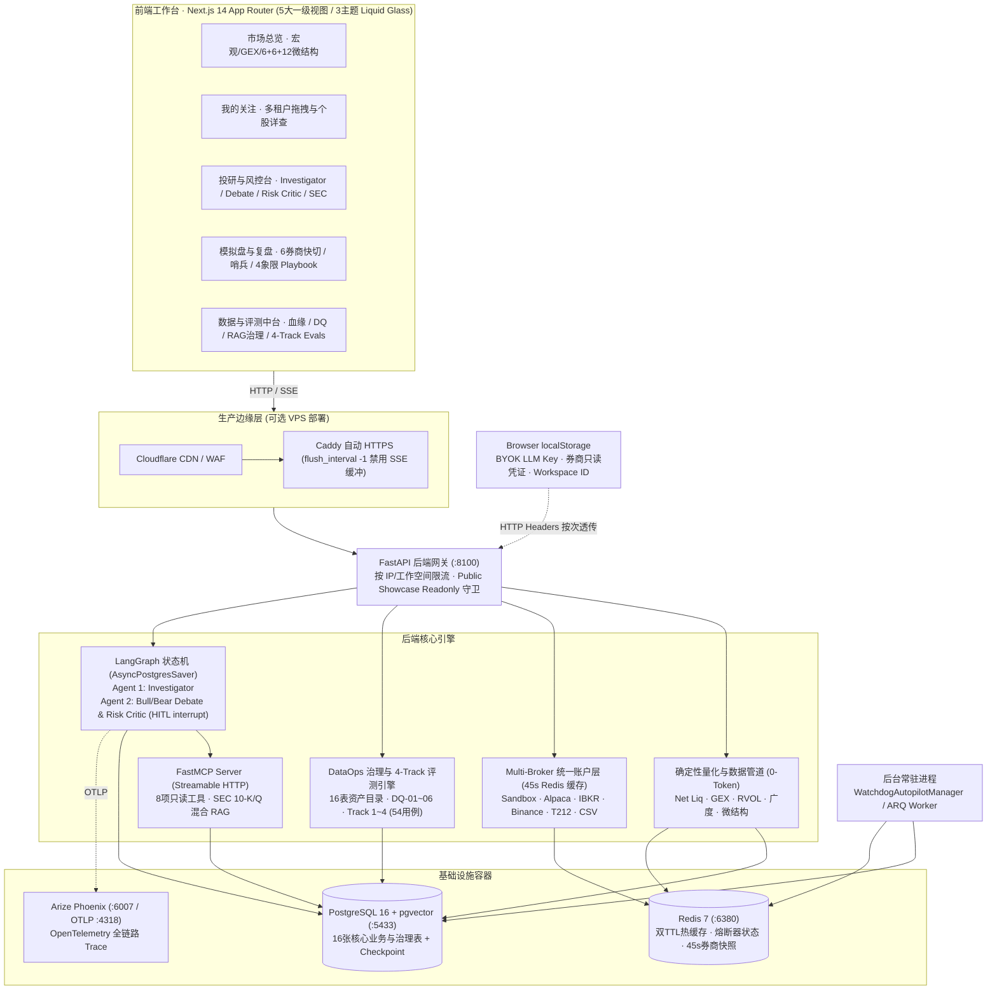

# MarketElite 系统架构设计规范（v1.0）

> 核心定位：**1 个零 Token 确定性数据驾驶舱底座 + 3 个职责隔离的闭环 Agent + DataOps 与 4-Track 全栈评测治理中台**。

---

## 1. 全栈系统拓扑

---

## 2. 关键架构取舍与工程边界

### 2.1 确定性管道 vs Multi-Agent 职责隔离
* **零 Token 确定性底座**：所有日线 K 线、MACD/RSI/ATR/RVOL、美联储净流动性、Black-Scholes `Estimated GEX`、市场广度、11 板块轮动与 1% 最大回撤仓位计算均由纯 Python 算子定时完成并缓存至 Redis/PostgreSQL。
* **3 个真实 Agent 各自解决不可规则化的问题**：
  1. **Agent 1 — Investigator（主脑）**：面向跨指标异动与复杂问题动态规划 FastMCP 工具链，对万字 SEC 文件进行混合检索与结构化研报合成（内置 40 条提示词库、10 秒动态轮播、多轮历史手风琴折叠）。
  2. **Agent 2 — Adversarial Debate & Risk Critic（对抗投决与独立风控）**：故意隔离乐观情绪上下文。`DebateRunner` 支持免 Key 压测及大模型多空交锋并输出大白话核心发现；`Risk Critic` 独立锁定 `1%` 单笔止损预算、产出 Bracket 价位梯，通过 PostgreSQL Checkpointer `interrupt()` 挂起等待人工拍板。
  3. **Agent 3 — Watchdog & Reflection（7×24 后台哨兵与进化教练）**：独立生命周期在后台定频巡检盘中量价/催化异动；每笔交易平仓后自动产生 `过程纪律 × 市场结果` 4 象限归因、计算超额 Alpha vs SPY，并提炼写入可置顶的 `EpisodicMemory` 长期铁律库。

### 2.2 精准混合 RAG 边界（不滥用向量库）
* **禁止进向量库的数据**：精确价格、GEX 数值、技术指标、日历时间、账户仓位、DQ 健康分全部走 SQL 关系表 + Redis JSON + 精准工具函数，确保数值 100% 精准无幻觉。
* **按需混合 RAG（`pgvector` HNSW 余弦 + PostgreSQL `tsvector` GIN BM25 经 RRF 融合）**：
  1. `sec_filing_cache` / `sec_filing_chunks`：按章节切块的 SEC EDGAR 10-K/10-Q/8-K 长文本；无向量模型配置时平滑退化为纯 BM25 检索。
  2. `episodic_memories`：跨周期交易复盘错题与置顶铁律，按当前 Regime 标签自动注入调研与风控上下文。

### 2.3 六大外部数据源 / 交易商适配器与 0-Key 演示快照
* **Unified Broker Layer（[broker.py](../backend/app/services/broker.py)）**：通过统一协议适配 **Sandbox（\$100k 24/7 拟真）**、**Alpaca Paper**、**IBKR Flex Read-Only**、**Binance Spot Read-Only**、**Trading212 Live/Demo Read-Only** 与 **通用 CSV 账本**。
* 对远端券商接口（Alpaca/T212/IBKR/Binance）并发拉取 `account` / `positions` / `orders` 并加设 **45 秒 Redis 快照缓存**，同步/平仓/撤单/重启恢复等写操作自动触发定向失效。
* **0-Key 开源冷启动（[demo_seed.py](../backend/app/services/demo_seed.py)）**：空库且未配置 Alpaca Key 启动时自动（或通过 CLI）灌入完全脱敏的演示 K 线、GEX、宏观 Regime、自选与演练复盘样本，绝不覆盖已有真实数据。

---

## 3. 九大生产级稳定性与安全防线

1. **Agent 防死循环与超窗保护**：`agent_max_steps=8`、`45s` 墙钟超时、`agent_max_context_tokens=14000`；工具连续重复哈希拦截并在超限前跳转 `force_synthesize` 优雅收口。
2. **下单隔离硬红线**：任何对话式 LLM 均无权调用实盘/模拟下单工具；实际委托只能由 HITL `resume_trade` 确定性节点在 `X-Admin-Token`（生产环境必填）与二次人数校验通过后发出；只读券商模式仅生成人工参考单并在本地沙盒演练记账。
3. **弹性缓存与熔断器**：指数退避重试 + 60 秒 Redis 断路器 + **Soft-TTL / Hard-TTL 双级缓存**；上游抖动时返回带 `[Stale Cache]` 标注的兜底数据与降级来源追踪。
4. **PostgreSQL Checkpointer 持久化断点**：采用 `langgraph-checkpoint-postgres` (`AsyncPostgresSaver` + `AsyncConnectionPool`，支持 `autocommit=True`、`prepare_threshold=0`、`dict_row`) 实现跨刷新、跨小时 HITL 断点恢复。
5. **浏览器本地 BYOK 与 `ALLOW_SERVER_LLM_FALLBACK=false`**：大模型 API Key、IBKR/Binance/T212 只读凭证全部保存在访客浏览器 `localStorage`，随请求 Header 单次透传；服务端默认拒绝代付访客推理额度。
6. **公网多租户工作空间隔离（`X-Workspace-Id`）**：6 张核心用户业务表（`paper_trades`、`watchdog_alerts`、`episodic_memories`、`user_watchlist_items`、`investigator_threads`、`imported_holdings`）全部强制带 `workspace_id` 索引隔离（由 DataPlatform `DQ-05` 持续审计）。
7. **定位 A 作品集只读守卫（`PUBLIC_SHOWCASE_READONLY`）**：公网展示站开放全量观测与只读 API；触发 4-Track Evals、管道同步、RAG 测试、熔断重置、手动实盘修改等变更操作必须通过 `X-Admin-Token` 校验。
8. **4-Layer DataOps 观测与 6 项 DQ 守门**：覆盖 ODS → DWD → DWS → ADS 16 张数据表血缘追踪，定期审计行情极值、宏观连续性、GEX 墙结构、Discover 双语完整率、多租户隔离与微结构缓存健康。
9. **4-Track 全栈评测回归**：上线或改 Prompt 后可在「数据与评测中台」或 CLI 一键运行 **54 条用例**（含确定性算子、RAG 数值防幻觉、LangGraph `pass^k` 轨迹一致率及 Prompt 注入/反事实红队验证）并持久化基线比对。
